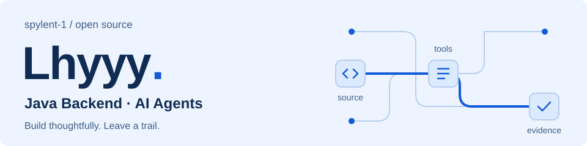

<picture>
  <source media="(prefers-color-scheme: dark)" srcset="assets/header-dark.svg">
  <source media="(prefers-color-scheme: light)" srcset="assets/header-light.svg">
  
</picture>

# Hi, I'm Lhyyy

**Java Backend · AI Agents** — 探索后端系统与可追溯的 AI 工具。

我用 Java 和 Python 构建项目，关注业务流程、工具执行与验证记录。这里分享正在打磨的开源作品，欢迎试用、提问和交流实现思路。

[探索作品 ↓](#selected-work) · [技术栈](#toolbox) · [一起交流](#lets-connect)

## Selected Work

### [VeriTrail](https://github.com/spylent-1/veritrail-agent) · 可审计的编码 Agent

让“查了什么、改了什么、验证了什么”有迹可循。一个面向 Java / Python 仓库的编码 Agent CLI，将源码定位、审批后编辑、测试验证和会话恢复串起来。

- **有据可查**：源码引用包含文件路径、行范围与哈希，工具执行留下记录。
- **可控修改**：具体编辑与测试需审批；成功写入后，旧验证状态立即失效。
- **持续工作**：SQLite 保存会话与执行结果，快照支持冲突检查、恢复和回滚。

`Python` `Tool Calling` `SQLite` `MCP`

[查看源码 ↗](https://github.com/spylent-1/veritrail-agent) · [快速开始](https://github.com/spylent-1/veritrail-agent#quick-start) · [架构设计](https://github.com/spylent-1/veritrail-agent/blob/main/docs/architecture.md)

### [F1 Intelligence](https://github.com/spylent-1/F1-race-data-and-intelligent-analysis-system) · 赛事数据与智能分析

把赛事数据查询与 AI 分析放进同一个业务场景：结构化数据来自领域查询，规则问答带来源引用，工具执行与流式回答可追踪。

- **领域工具**：围绕赛季、赛果、积分榜和车手对比，提供受控的只读查询。
- **规则检索**：通过 Qdrant 检索规则知识，返回引用，并对低相关结果拒答。
- **会话体验**：SSE 流式输出、取消与超时处理，配合工具轨迹和评测流程。

`Java` `Spring Boot` `Spring AI` `Qdrant` `Next.js`

[查看源码 ↗](https://github.com/spylent-1/F1-race-data-and-intelligent-analysis-system) · [部署指南](https://github.com/spylent-1/F1-race-data-and-intelligent-analysis-system/blob/main/docs/deployment.md) · [接口文档](https://github.com/spylent-1/F1-race-data-and-intelligent-analysis-system/blob/main/docs/api.md)

#### More Backend Practice

**[FlashPass ↗](https://github.com/spylent-1/flashpass)** · 持续开发 
限量资源预约的后端实践：Redis Token 身份识别、资源缓存与同步名额申请；候补和异步流程仍在路线图中。 
`Spring Boot` `MySQL` `Redis`

**[MealFlow ↗](https://github.com/spylent-1/mealflow)** · 持续开发 
餐饮管理后端的模块化实践：员工登录、JWT 鉴权与 Maven 多模块组织；订单与支付链路尚待完善。 
`Java` `JWT` `MyBatis` `Maven`

## Toolbox

**Backend** · Java / Spring Boot / MySQL / Redis / MyBatis 
**AI** · Python / Spring AI / Tool Calling / RAG / Qdrant 
**Engineering** · Git / Maven / Docker / GitHub Actions / pytest

## Let's Connect

对 Agent 的可控执行、后端设计或 F1 数据感兴趣？欢迎带着使用反馈、可复现的问题或实现建议来交流。

[VeriTrail Issues ↗](https://github.com/spylent-1/veritrail-agent/issues) · [F1 Issues ↗](https://github.com/spylent-1/F1-race-data-and-intelligent-analysis-system/issues)

Build thoughtfully. Leave a trail.
